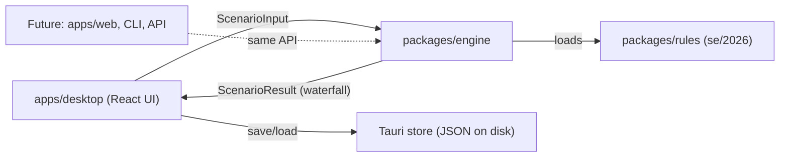

# 01 — Architecture

## 1. Goals

| Goal | Consequence for design |
| --- | --- |
| **Correctness & auditability** — every krona of revenue must be accounted for | Engine produces a line-item *waterfall* that reconciles to revenue exactly (invariant tested) |
| **Open for future development** (new scenarios, new tax years, web/mobile) | Pure TS engine with zero UI/OS deps; scenarios are plugins; tax rules are versioned data |
| **Windows 11 desktop first, offline** | Tauri 2 shell, local storage, no backend |
| **Swedish domain clarity** | Swedish terms kept as identifiers in rules (e.g. `arbetsgivaravgift`), UI bilingual sv/en |

Non-goals (v1): bookkeeping, payroll filing, SIE export, multi-user, cloud sync.

## 2. High-level structure (monorepo)

```
lyvan-payout/
├─ apps/
│  └─ desktop/                 # Tauri 2 + React UI (Windows 11)
│     ├─ src/                  # React app
│     └─ src-tauri/            # Rust shell (minimal: window, store, dialogs)
├─ packages/
│  ├─ engine/                  # PURE TypeScript calculation engine (no deps on UI/Tauri)
│  │  ├─ src/core/             # money, rounding, solver, waterfall builder, invariants
│  │  ├─ src/tax/              # personal tax, employer fees, egenavgifter, 3:12, pension
│  │  ├─ src/scenarios/        # one folder per scenario (plugin)
│  │  ├─ src/registry.ts       # scenario registry
│  │  └─ src/index.ts          # public API
│  ├─ rules/                   # Versioned tax-year rule sets (data only)
│  │  └─ src/se/2026.ts
│  └─ ui-kit/ (optional later) # shared React components if a web app is added
├─ fixtures/                   # golden test cases (verified against Skatteverket)
└─ docs/
```



**Dependency rule:** `apps/* → engine → rules`. Never the reverse. Engine must run in Node (tests),
browser, and Tauri webview unchanged.

## 3. Engine design

### 3.1 Public API

```ts
// packages/engine/src/index.ts
export function calculate(scenarioId: ScenarioId, input: ScenarioInput, rules: RuleSet): ScenarioResult;
export function calculateAll(common: CommonInput, perScenario: Partial<Record<ScenarioId, unknown>>, rules: RuleSet): ScenarioResult[];
/** Like calculateAll, but a scenario with invalid options is reported in `failures` instead of throwing. */
export function calculateAllSettled(common: CommonInput, perScenario: Partial<Record<ScenarioId, unknown>>, rules: RuleSet): { results: ScenarioResult[]; failures: ScenarioFailure[] };
export function sweep(scenarioId: ScenarioId, input: ScenarioInput, revenues: number[], rules: RuleSet): SweepPoint[];
export function optimize(scenarioId: 'own-ab', input: OwnAbInput, rules: RuleSet, objective?: Objective): OptimizeResult; // best salary/dividend split
export function getRuleSet(country: 'SE', year: number): RuleSet;
export const scenarios: ScenarioDefinition[]; // registry, for UI generation
export class EngineInputError extends Error { scope: string; issues: { path: string; message: string; code: string; limit?: number }[] }
export function isReconciled(result: ScenarioResult): boolean; // lines sum to revenue AND the balancing line only absorbed rounding
```

### 3.2 Scenario plugin contract

```ts
export interface ScenarioDefinition<I extends object = object> {
  id: ScenarioId;                    // 'salaried' | 'revenue-share' | 'umbrella' | 'sole-trader' | 'own-ab' | (future)
  labelKey: string;                  // i18n key
  descriptionKey: string;
  inputSchema: z.ZodType<I>;         // validation + defaults; UI form is generated/guided from it
  defaults(rules: RuleSet): I;
  calculate(common: CommonInput, input: I, rules: RuleSet): ScenarioResult;
}
```

Adding scenario 6 (e.g. *holding-AB*, *foreign consultant SINK*) = new folder + register. No UI rewrite.

### 3.3 Inputs

```ts
interface CommonInput {
  taxYear: number;                 // 2026
  revenue: number;                 // annual billed revenue SEK ex. VAT (primary input)
  revenueMode?: 'annual' | 'hourly'; hourlyRate?: number; billableHours?: number; // convenience, UI derives revenue
  overhead: number;                // SEK/yr direct costs (accounting, IT, insurance...) — or overheadPct
  person: {
    birthYear: number;             // drives age rules (youth/65+ fees, grundavdrag variant)
    municipalTaxRate: number;      // e.g. 0.3238 (kommun+region); default = national average
    churchMember: boolean; churchFeeRate?: number;
    burialFeeRate: number;         // begravningsavgift
  };
}
```

Scenario-specific inputs are in [03-domain-tax-rules-2026.md](03-domain-tax-rules-2026.md).

### 3.4 Output — the waterfall

```ts
type Party = 'consultant' | 'company' | 'state' | 'pension' | 'provider';
type LineKind = 'revenue' | 'cost' | 'tax' | 'fee' | 'payout' | 'pension' | 'retained' | 'subtotal';

interface Line {
  key: string;            // stable id, e.g. 'employer_fees'
  labelKey: string;       // i18n
  amount: number;         // SEK, signed (+ inflow, − outflow), whole kronor
  party: Party;           // who receives this money
  kind: LineKind;
  pctOfRevenue: number;   // derived
  formula?: string;       // human-readable "31.42% × 660 400" for transparency/audit
}

interface ScenarioResult {
  scenarioId: ScenarioId;
  lines: Line[];                      // ordered waterfall
  totals: {
    revenue: number;
    grossPayout: number;              // salary (+ dividend before personal tax, where relevant)
    netCash: number;                  // money in consultant's pocket after all taxes
    pensionValue: number;             // premiums to occupational/private pension (excl. SLP)
    consultantValue: number;          // netCash + pensionValue
    totalToState: number;             // all taxes + fees
    companyRetained: number;          // LYVAN margin / overhead / provider fee
    effectiveTaxRate: number;         // totalToState / (revenue − overhead)
    netPctOfRevenue: number;
  };
  warnings: Warning[];                // e.g. DIVIDEND_EXCEEDS_GRANSBELOPP, SALARY_BELOW_SGI_CAP
  assumptions: string[];              // i18n keys of assumptions applied
  meta: { ruleSetId: string; engineVersion: string };
}
```

**Invariant (must be unit/property-tested for every scenario):**
`sum(amount of all non-subtotal outflow lines) == revenue` within ±1 kr per line (rounding), i.e.
`netCash + pensionValue + totalToState + companyRetained + overhead == revenue`.

`Waterfall.finish()` forces the sum by pushing the rounding residual into one "balance" line, so the sum alone
proves nothing. The invariant therefore also requires `|meta.balanceAdjustment| ≤ 10 kr` (`MAX_BALANCE_ADJUSTMENT`),
unless the result carries an `error` warning (budget too low, loss), where the line legitimately carries the shortfall.

### 3.5 Core utilities

- `money.ts` — SEK as `number`, explicit rounding helpers: `roundKr`, `floorTo100` (taxable income),
  `ceilTo100` (grundavdrag). Rounding only at the points Skatteverket rounds. No floats in display.
- `solver.ts` — monotone bisection: "find gross salary S such that totalEmployerCost(S) = budget".
  Needed because pension (ITP1) is piecewise in S. Tolerance 0.5 kr, max 100 iterations.
- `waterfall.ts` — builder that appends lines and computes subtotals + pctOfRevenue.
- `invariants.ts` — `assertReconciles(result)` used in tests and (dev builds) at runtime.

### 3.6 Tax modules (shared by scenarios)

| Module | Function | Used by |
| --- | --- | --- |
| `tax/employerFees.ts` | `employerFees(gross, age, date)` | 1, 2, 3, 5 |
| `tax/personalIncomeTax.ts` | `incomeTax(earnedIncome, person, rules)` → grundavdrag, taxable, kommunal, statlig, jobbskatteavdrag, allmän pensionsavgift (+credit), begravning, kyrka, net | 1–5 |
| `tax/pension.ts` | `itp1Premium(monthlyGross)`, `customPension(pct)`, `slp(premium)` | 1, 2, 3, 5 |
| `tax/egenavgifter.ts` | `egenavgifter(surplus, age)` incl. nedsättning | 4 |
| `tax/threeTwelve.ts` | `gransbelopp(...)`, `dividendTax(dividend, gransbelopp, ...)` | 5 |
| `tax/corporateTax.ts` | `corporateTax(profit)` | 5 |

### 3.7 Rules as data

```ts
// packages/rules/src/se/2026.ts
export const SE_2026: RuleSet = {
  id: 'SE-2026', country: 'SE', year: 2026, verified: false, sources: [...],
  pbb: 59_200, ibb: 83_400, ibbPrevYear: 80_600,
  employerFees: { standard: 0.3142, age66plus: 0.1021, youth: { rate: 0.2081, ages: [19, 23], capMonthly: 25_000, from: '2026-04-01', to: '2027-09-30' } },
  ...
};
```

- Every value has a `// source:` comment and the RuleSet has `verified: boolean`.
  UI shows a banner if `verified === false`.
- New tax year = copy file, update values, add fixtures. Engine code ideally unchanged.

## 4. Desktop app architecture

```
apps/desktop/src/
├─ app/            # App shell, routing (TanStack Router or simple tab state), providers
├─ features/
│  ├─ calculator/  # revenue input, common assumptions, scenario cards
│  ├─ compare/     # stacked bar chart of all scenarios
│  ├─ detail/      # per-scenario waterfall table + formulas
│  ├─ sweep/       # revenue sweep line chart
│  ├─ saved/       # named saved calculations
│  └─ settings/    # tax year, language, defaults, branding
├─ state/          # Zustand store: inputs → derived results via engine (memoized)
├─ lib/            # formatters (sv-SE currency), export (CSV, print-to-PDF), tauri bridge
├─ i18n/           # sv.json, en.json
└─ styles/         # Tailwind theme tokens (LYVAN brand)
```

- **State flow:** inputs (Zustand) → `useMemo(calculateAll)` → views. Engine is synchronous and fast
  (< 1 ms per scenario); sweep (≈ 100 points × 5) also synchronous; move to a Web Worker only if > 50 ms.
- **Persistence:** `@tauri-apps/plugin-store` → `%APPDATA%\se.lyvan.payout\store.json`
  (settings + saved calculations, schema-versioned with migrations).
- **Tauri bridge isolated** in `lib/platform.ts` so a future web build swaps it for `localStorage`.
- **Rust side** stays minimal (no business logic in Rust).

## 5. Extension roadmap (designed-for, not built in v1)

| Future feature | Hook already in design |
| --- | --- |
| New scenarios (holding AB, SINK, foreign) | Scenario registry |
| Tax year 2027+ | `packages/rules/src/se/<year>.ts` + fixtures |
| Web app (could live in JobSearch_system or standalone Next.js) | Engine is pure TS; `platform.ts` abstraction |
| LYVAN firm-level P&L (many consultants, bench, utilization) | `companyRetained` per result; add `portfolio` package aggregating results |
| Contract/offer generator ("your payout at LYVAN") | Results are serializable JSON + print view |
| Monthly payslip simulation | Personal tax module already separates components |
| Auto-update | Tauri updater plugin |
